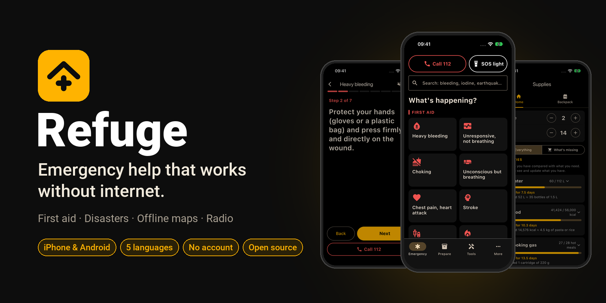
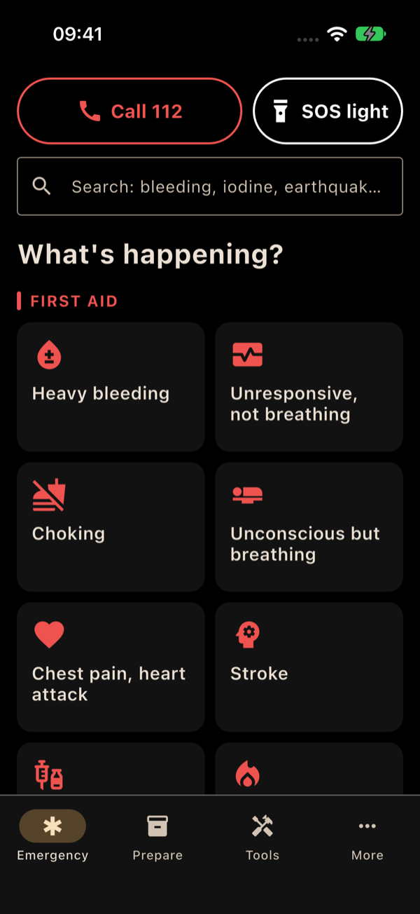
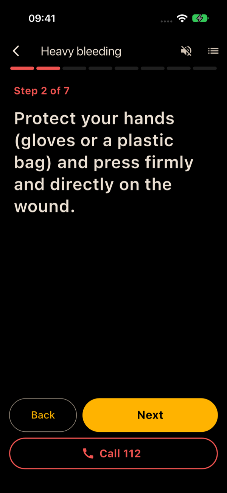
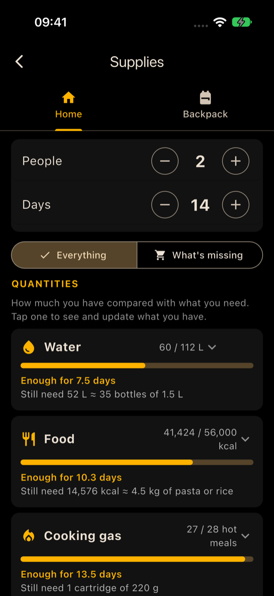
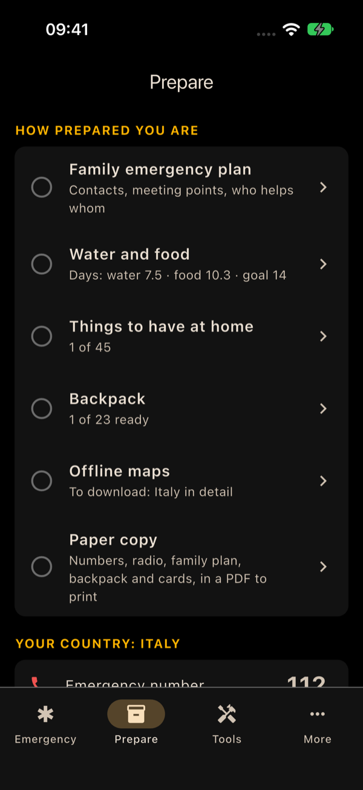
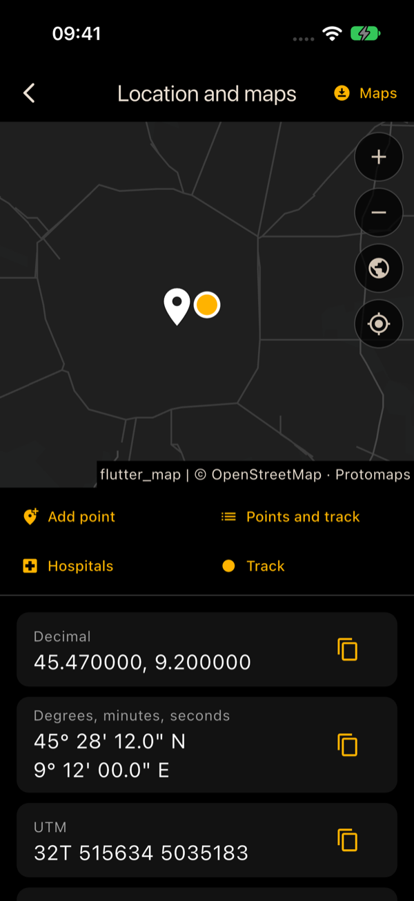
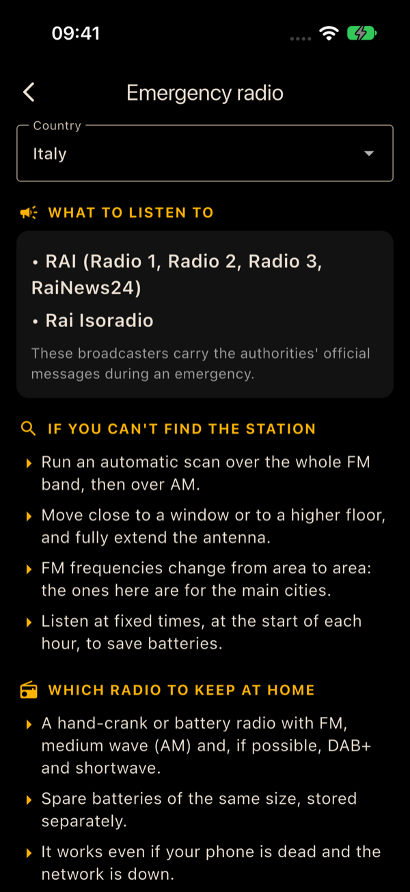

<p align="center">
  
</p>

<p align="center">
  <b>App gratuita e open source per le emergenze in Europa, che funziona senza internet.</b><br>
  Nessun account · Nessuna pubblicità · Nessun tracciamento · iPhone e Android · Italiano, English, Français, Deutsch, Español
</p>

<p align="center">
  <a href="#installare">Installare</a> ·
  <a href="#cosa-fa">Cosa fa</a> ·
  <a href="#da-dove-vengono-i-contenuti">Fonti</a> ·
  <a href="#contribuire">Contribuire</a> ·
  <a href="README.md">English</a>
</p>

Quando succede qualcosa di grave (un blackout, un'alluvione, un terremoto, un allarme aereo, qualcuno che perde sangue
davanti a te), internet e la rete telefonica sono spesso le prime cose a non funzionare, e nessuno ragiona a mente
lucida. Refuge mette sul telefono quello che serve **prima** di quel momento: cosa fare, passo per passo; le mappe
offline; quale radio ascoltare; il piano della famiglia; quanta acqua e quanto cibo hai.

## Perché installarla adesso e non dopo

- **Durante una crisi non si scarica niente.** Le reti si intasano o cadono, e store, mappe e siti smettono di
  caricarsi. Refuge deve essere già sul telefono, con mappe e guide scaricate col Wi‑Fi.
- **L'UE chiede a ogni famiglia di cavarsela da sola per almeno 72 ore.** La
  [strategia europea per la preparazione](https://commission.europa.eu/topics/preparedness_en) e le sue linee guida
  sull'autosufficienza di 72 ore dicono cosa tenere in casa e nello zaino di emergenza. Refuge le trasforma in una
  lista, con le quantità per la tua famiglia.
- **Sotto stress nessuno ricorda i passaggi.** Ogni scheda mostra un passo breve alla volta, a caratteri grandi,
  nella tua lingua.
- **Prepararsi richiede una sera, non una crisi.** Compila il piano della famiglia, spunta le scorte, stampa la copia
  su carta: poi è fatta.

## Cosa fa

### Emergenza (la prima schermata)

- **Chiama 112** (o il numero del tuo paese) e **SOS luce** sempre in alto. L'SOS parte subito a lampeggiare, con la
  torcia e con lo schermo.
- **22 schede passo per passo**, in ordine di urgenza:
  - rosse, primo soccorso: sangue che esce forte, non risponde e non respira (rianimazione), soffoca, svenuto ma
    respira, dolore al petto e infarto, ictus, reazione allergica grave, ustione, colpo alla testa, calo di zuccheri,
    freddo estremo e ipotermia, colpo di calore, morso di vipera, persona sotto shock;
  - gialle, pericoli: allarme aereo ed esplosioni, allarme nucleare, nube tossica, terremoto, incendio, alluvione;
  - blu, sopravvivenza: acqua da bere, blackout.
- Ogni scheda dice anche cosa **non** fare, e il numero di emergenza è a un tocco in ogni passo.
- **Ricerca** che capisce parole a metà ed errori di battitura: "sangiue", "iodio", "terremoto".

### Prepararsi

- **Quanto sei pronto**: cosa è fatto e cosa manca, voce per voce: piano della famiglia, acqua e cibo per i
  giorni che scegli, cose da avere in casa, zaino, mappa dettagliata del tuo paese, copia su carta.
- I **numeri di emergenza** del tuo paese, le **allerte sul telefono** (IT-alert, NL-Alert, Cell Broadcast…) e le
  **sirene**.
- **Piano di emergenza della famiglia**: contatti, punti d'incontro, rifugio più vicino, chi prende i bambini, chi ha
  bisogno di aiuto, farmaci.
- **Da scaricare finché c'è internet**: mappe offline ed enciclopedie.
- **Copia su carta**: un PDF da stampare con numeri, radio, piano della famiglia, zaino e tutte le schede, per quando
  il telefono è scarico o rotto.

### Strumenti

| Strumento | Cosa fa |
|---|---|
| Radio in emergenza | Cosa ascoltare nel tuo paese, frequenze FM nelle città principali, onde medie e DAB+, quale radio tenere in casa |
| Fallout | Dopo un'esplosione nucleare: quanto restare al riparo e cosa fare in ogni fase, con promemoria anche ad app chiusa |
| Scorte | Quanta acqua, cibo, gas per cucinare ed energia servono alla tua famiglia per i giorni che scegli, cosa hai e cosa manca. Lo zaino è collegato alle scorte di casa, con la lista "prima di uscire" e un controllo ogni 6 mesi |
| Manuali e guide | Documenti ufficiali europei (linee guida UE sulle 72 ore, primo soccorso ERC e IFRC, primo soccorso psicologico dell'OMS, guide nazionali), guide della Protezione Civile, enciclopedie offline (WikiMed, Wikipedia, Wikivoyage) |
| Torcia e SOS | Torcia, SOS lampeggiante, luce dallo schermo |
| Posizione e mappe | Posizione GPS nei formati che usano i soccorsi (decimale, gradi-primi-secondi, UTM, MGRS), mappe offline, punti salvati con distanza e direzione, registrazione del percorso, ospedali più vicini: tutto senza internet |
| Bussola | Direzione e punti cardinali |
| Morse | Manda un messaggio con la luce |

## Cosa ti evita

- Cercare sul web in preda al panico, su una rete che non va.
- Chiederti se quello che leggi online è giusto: ogni passo viene da una fonte ufficiale.
- Andare a occhio con acqua e cibo da comprare, e dimenticare cosa c'è nello zaino.
- Non sapere quale radio dà gli annunci ufficiali, né su quale frequenza.
- Perderti senza campo: il GPS funziona offline e la mappa è già sul telefono.
- Installare cinque app diverse per torcia, bussola, mappe, appunti e liste.
- Account, pubblicità e tracciamento: i tuoi dati restano sul telefono.

## Schermate

| | | |
|:-:|:-:|:-:|
|  |  |  |
| Emergenza | Scheda passo per passo | Scorte |
|  |  |  |
| Quanto sei pronto | Posizione e mappa offline | Radio in emergenza |

Le schermate sono in inglese; l'app segue la lingua scelta.

## Installare

> [!NOTE]
> Refuge è in beta. La prima versione sarà pubblicata in [Releases](https://github.com/ferdinandobons/refuge/releases)
> dopo le prove su telefoni Android. Fino ad allora si può [compilare dal codice](#compilare-dal-codice).

### Android

1. Dal telefono apri l'[ultima release](https://github.com/ferdinandobons/refuge/releases/latest) e scarica
   `refuge-<versione>.apk`.
2. Apri il file. Se Android lo chiede, consenti l'installazione di app dal browser o dal gestore file.
3. Per aggiornare, installa il nuovo APK sopra il vecchio: i tuoi dati restano.

### iPhone

Apple permette di installare app solo dall'App Store o firmate con un ID Apple:

- **App Store / TestFlight**: in programma (serve l'iscrizione all'Apple Developer Program).
- **Installazione manuale**: scarica `refuge-<versione>-unsigned.ipa` da
  [Releases](https://github.com/ferdinandobons/refuge/releases) e installala con [AltStore](https://altstore.io) o
  [Sideloadly](https://sideloadly.io) usando il tuo ID Apple.
- **Compilala tu con Xcode** (ID Apple gratuito): vedi [Compilare dal codice](#compilare-dal-codice).

> [!WARNING]
> Con un ID Apple gratuito, dopo 7 giorni iOS non apre più l'app se non viene rinnovata (AltStore può farlo da solo
> col Wi‑Fi). Per un'app di emergenza conta: rinnovala spesso, o passa alla versione dell'App Store quando ci sarà.

### Al primo avvio

Scegli lingua e paese, poi cosa scaricare finché hai il Wi‑Fi: mappe del tuo paese, documenti ufficiali,
enciclopedie. Da lì in poi tutto funziona senza internet.

## Privacy

- Nessun account, nessuna pubblicità, nessuna statistica, nessun tracciamento.
- Piano della famiglia, scorte, punti salvati e percorsi restano solo sul telefono.
- La posizione la calcola il GPS del telefono e non viene mandata da nessuna parte.
- L'app va su internet solo quando glielo chiedi: per scaricare mappe ([Protomaps](https://protomaps.com), dati
  OpenStreetMap), enciclopedie (la biblioteca di [Kiwix](https://kiwix.org)) e documenti ufficiali (dal sito
  dell'ente), o per aprire un link.
- I promemoria sono programmati sul telefono: non c'è nessun server.

## Da dove vengono i contenuti

Le schede sono riassunti brevi, scritti con parole nostre, di linee guida ufficiali:

- **Primo soccorso**: European Resuscitation Council, [linee guida ERC 2025](https://www.erc.edu) (First Aid); IFRC,
  *International First Aid, Resuscitation and Education Guidelines 2025*; OMS, *Primo soccorso psicologico* (2011).
- **Preparazione**: linee guida UE sulla preparazione della popolazione e sull'autosufficienza di 72 ore (Commissione
  europea, 2026).
- **Pericoli**: protezioni civili nazionali di Italia (Dipartimento della Protezione Civile), Germania (BBK), Svezia
  (MCF), Paesi Bassi (Denk vooruit) e Regno Unito (UKHSA).

Ogni frase di ogni scheda è elencata con la sua fonte (documento, sezione, pagina) in
[docs/verifica-schede.md](docs/verifica-schede.md); le altre lingue traducono le stesse frasi. La ricerca sulle fonti
europee e sulle licenze è in [docs/fonti-ue.md](docs/fonti-ue.md). Nell'app: Altro › Licenze e attribuzioni.

> [!IMPORTANT]
> Refuge non sostituisce un corso di primo soccorso né le indicazioni delle autorità. In emergenza chiama il 112 e
> segui le autorità. Le schede sono state controllate frase per frase sulle fonti, ma non ancora riviste da
> professionisti sanitari e di protezione civile: se lo sei, la tua revisione è benvenuta.

## Lingue e paesi

- **Lingue**: italiano, inglese, francese, tedesco, spagnolo.
- Numeri, allerte sul telefono, sirene e radio **del paese**: Italia, Francia, Germania, Spagna, Austria, Svizzera,
  Belgio, Paesi Bassi, Lussemburgo, Portogallo, Regno Unito, Irlanda. Negli altri paesi l'app usa il 112 e i
  contenuti generali.
- Le guide della Protezione Civile ci sono tutte in italiano; le guide "cosa fare" valide in tutta Europa (terremoto,
  alluvione, incendi boschivi, maremoto, dighe, incidenti industriali e nucleari) sono anche tradotte.

## Compilare dal codice

Serve [Flutter](https://docs.flutter.dev/get-started/install) 3.47 (canale stable); Xcode per iPhone, l'Android SDK
per Android.

```bash
git clone https://github.com/ferdinandobons/refuge.git
cd refuge
flutter pub get
flutter test
```

- **Android**: collega il telefono e lancia `flutter run --release`, oppure crea l'APK con `flutter build apk --release`
  e copia `build/app/outputs/flutter-apk/app-release.apk` sul telefono.
- **iPhone**: apri `ios/Runner.xcworkspace` in Xcode e scegli il tuo ID Apple in Signing & Capabilities, poi collega
  l'iPhone e lancia `flutter run --release`. Sul telefono attiva la Modalità sviluppatore (Impostazioni › Privacy e
  sicurezza) e autorizza lo sviluppatore (Impostazioni › Generali › VPN e gestione dispositivi).

GitHub Actions crea l'APK e l'IPA non firmata ([.github/workflows/build.yml](.github/workflows/build.yml)); un tag
`v*` li pubblica come release.

## Contribuire

Ogni aiuto è benvenuto, soprattutto per:

- **controllare le schede** sulle fonti ufficiali, o rivederle se sei soccorritore, medico o lavori nella protezione
  civile;
- **frequenze radio** e sistemi di allerta di altri paesi, da fonti ufficiali;
- **traduzioni**, e prove su telefoni **Android**.

La regola per i contenuti: ogni frase deve venire da una fonte ufficiale, citata accanto. Le schede si generano con
[tool/cards/cards.py](tool/cards/cards.py), che scrive `assets/cards/cards.json` e `docs/verifica-schede.md`; il
catalogo delle scorte con [tool/supplies/checklist.py](tool/supplies/checklist.py). Prima di modifiche grandi apri una
issue. Specifica del progetto: [SPEC.md](SPEC.md).

## Licenze

- Codice: [GPL-3.0](LICENSE).
- Testi delle schede e traduzioni scritte per l'app: [CC BY-SA 4.0](https://creativecommons.org/licenses/by-sa/4.0/).
- I contenuti di terzi mantengono la loro licenza: guide della Protezione Civile CC BY 4.0, documenti della
  Commissione europea CC BY 4.0, dati OpenStreetMap ODbL, Wikipedia CC BY-SA 4.0. Le linee guida IFRC si possono
  copiare solo per uso non commerciale; i documenti ERC, OMS, BBK e MCF si scaricano dal sito dell'ente e restano
  loro. Elenco completo: [assets/legal/attributions.json](assets/legal/attributions.json).
