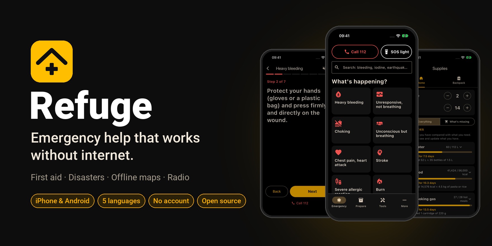
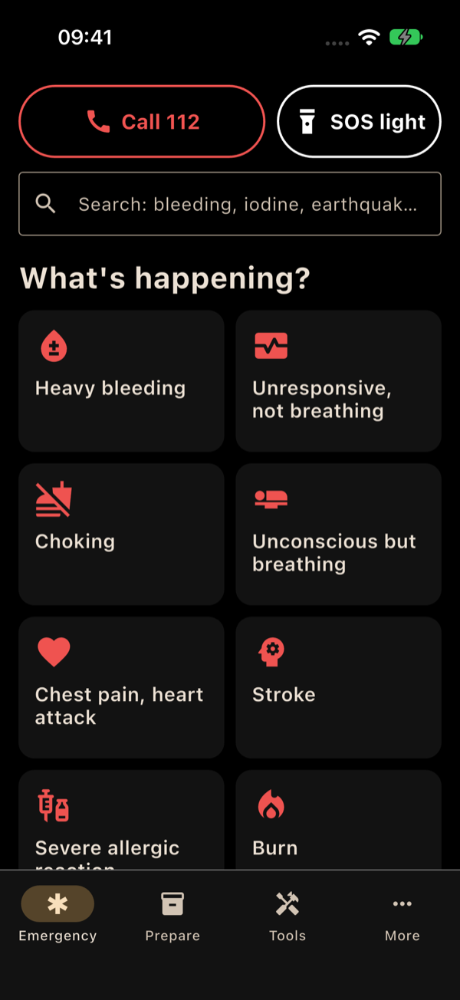
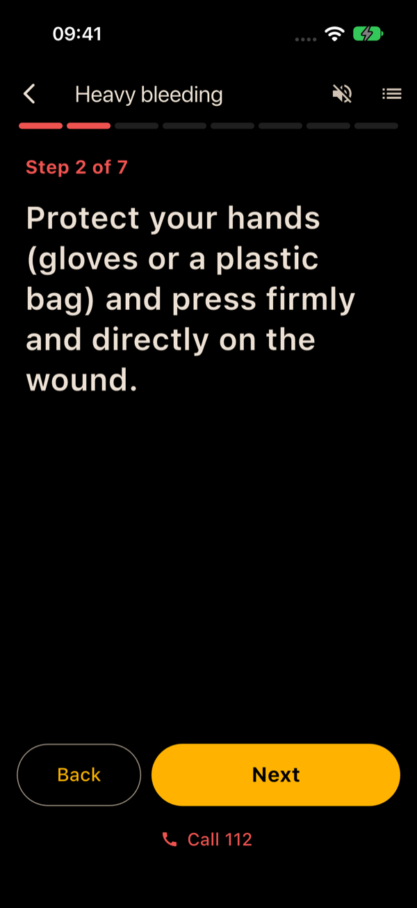
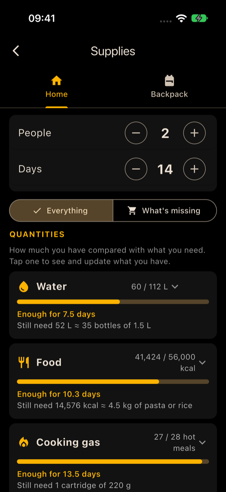
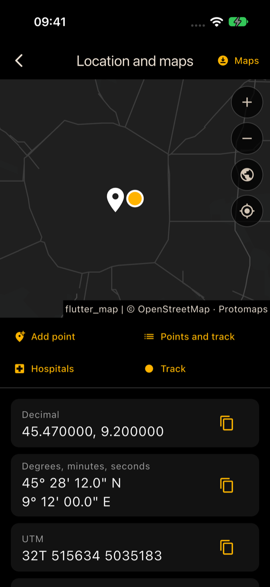
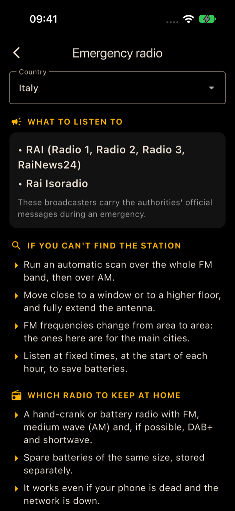
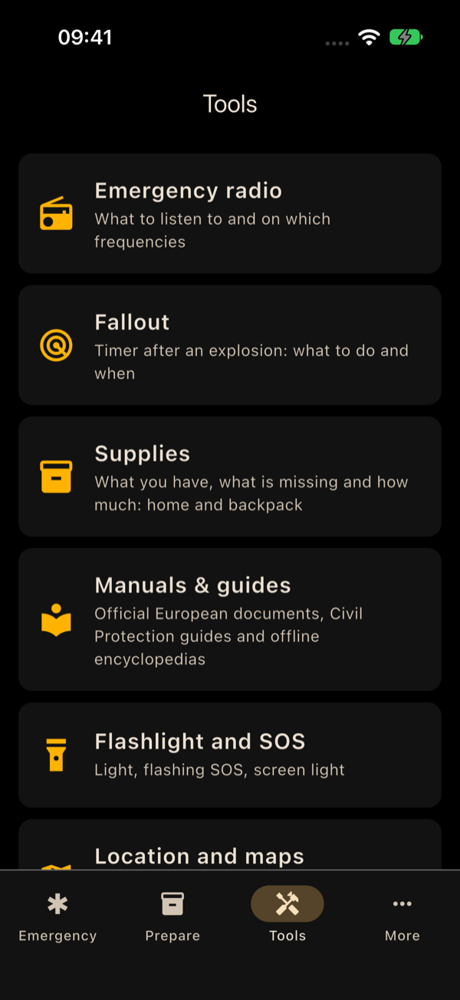

<p align="center">
  
</p>

<p align="center">
  <b>A free, open-source emergency app for Europe that works without internet.</b><br>
  No account · No ads · No tracking · iPhone and Android · English, Italiano, Français, Deutsch, Español
</p>

<p align="center">
  <a href="#install">Install</a> ·
  <a href="#what-it-does">What it does</a> ·
  <a href="#where-the-content-comes-from">Sources</a> ·
  <a href="#contributing">Contributing</a> ·
  <a href="README.it.md">Italiano</a>
</p>

When something serious happens (a blackout, a flood, an earthquake, an air-raid alarm, someone bleeding in front of
you), the internet and the phone network are often the first things to fail, and nobody thinks clearly. Refuge puts
what you need on your phone **before** that moment: what to do, step by step; offline maps; which radio station to
listen to; your family plan; and how much water and food you have.

## Why install it now, not later

- **In a crisis you can't download anything.** Networks get overloaded or go down, and app stores, maps and websites
  stop loading. Refuge has to be on your phone already, with its maps and guides downloaded on Wi‑Fi.
- **The EU asks every household to manage on its own for at least 72 hours.** The EU
  [Preparedness Union Strategy](https://commission.europa.eu/topics/preparedness_en) and its guidelines on 72-hour
  self-sufficiency say what to keep at home and in a go-bag. Refuge turns them into a checklist with the quantities
  for your household.
- **Under stress, nobody remembers the steps.** Each emergency card shows one short step at a time, in large text, in
  your language.
- **Preparing takes an evening, not a crisis.** Fill in the family plan, tick off your supplies, print the paper copy:
  then it's done.

## What it does

### Emergency (the first screen)

- **Call 112** (or your country's number) and **SOS light** always at the top. SOS starts flashing straight away, with
  the torch and the screen.
- **22 step-by-step cards**, sorted by urgency:
  - red, first aid: heavy bleeding, unresponsive and not breathing (CPR), choking, unconscious but breathing, chest
    pain, stroke, severe allergic reaction, burns, head injury, low blood sugar, hypothermia, heatstroke, snake bite,
    a person in shock or distress;
  - yellow, dangers: air raid and explosions, nuclear alert, toxic cloud, earthquake, fire, flood;
  - blue, survival: drinking water, power cut.
- Every card lists what **never** to do, and the emergency number is one tap away at every step.
- **Search** that understands partial words and typos: "bleding", "iodine", "earthquake".

### Prepare

- Your country's **emergency numbers**, **phone alerts** (IT-alert, NL-Alert, Cell Broadcast…) and **sirens**.
- **Family emergency plan**: contacts, meeting points, nearest shelter, who collects the children, who needs help,
  medicines.
- **Download while you have internet**: offline maps and encyclopedias.
- **Paper copy**: a PDF to print with numbers, radio, family plan, backpack and all the cards, for when the phone is
  flat or broken.

### Tools

| Tool | What it does |
|---|---|
| Emergency radio | What to listen to in your country, FM frequencies in the main cities, AM and DAB+, which radio to keep at home |
| Fallout | After a nuclear explosion: how long to stay sheltered and what to do in each phase, with reminders even when the app is closed |
| Supplies | How much water, food, cooking gas and power your household needs for the days you choose, what you have and what is missing. The backpack is linked to the home list, with a "before leaving" list and a check every 6 months |
| Manuals & guides | Official European documents (EU 72-hour guidelines, ERC and IFRC first aid, WHO psychological first aid, national guides), Italian Civil Protection guides, offline encyclopedias (WikiMed, Wikipedia, Wikivoyage) |
| Flashlight and SOS | Torch, flashing SOS, screen light |
| Location and maps | GPS position in the formats rescuers use (decimal, degrees-minutes-seconds, UTM, MGRS), offline maps, saved points with distance and direction, track recording, nearest hospitals: all without internet |
| Compass | Direction and cardinal points |
| Morse | Send a message with light |

## What it saves you from

- Searching the web in a panic, on a network that doesn't work.
- Wondering whether what you read online is right: every step comes from an official source.
- Guessing how much water and food to buy, and forgetting what is in the backpack.
- Not knowing which station carries official announcements, or on which frequency.
- Being lost without signal: GPS works offline, and the map is already on the phone.
- Installing five different apps for torch, compass, maps, notes and checklists.
- Accounts, ads and tracking: your data stays on your phone.

## Screenshots

| | | |
|:-:|:-:|:-:|
|  |  |  |
| Emergency | Step-by-step card | Supplies |
|  |  |  |
| Location and offline map | Emergency radio | Tools |

## Install

> [!NOTE]
> Refuge is in beta. The first release will be published under
> [Releases](https://github.com/ferdinandobons/refuge/releases) after testing on Android phones. Until then you can
> [build it from source](#build-from-source).

### Android

1. On your phone, open the [latest release](https://github.com/ferdinandobons/refuge/releases/latest) and download
   `refuge-<version>.apk`.
2. Open the file. If Android asks, allow installing apps from your browser or file manager.
3. To update, install the new APK over the old one: your data stays.

### iPhone

Apple only lets you install apps from the App Store or signed with an Apple ID:

- **App Store / TestFlight**: planned (it requires an Apple Developer Program membership).
- **Sideload**: download `refuge-<version>-unsigned.ipa` from [Releases](https://github.com/ferdinandobons/refuge/releases)
  and install it with [AltStore](https://altstore.io) or [Sideloadly](https://sideloadly.io) using your Apple ID.
- **Build it yourself with Xcode** (free Apple ID): see [Build from source](#build-from-source).

> [!WARNING]
> With a free Apple ID, iOS stops opening the app after 7 days unless it is refreshed (AltStore can do it
> automatically on Wi‑Fi). For an emergency app this matters: refresh it regularly, or switch to the App Store version
> when it is available.

### First launch

Choose your language and country, then what to download while you have Wi‑Fi: maps of your country, official
documents, encyclopedias. After that, everything works without internet.

## Privacy

- No account, no ads, no analytics, no tracking.
- The family plan, supplies, saved points and tracks are stored only on your phone.
- Your position is calculated by the phone's GPS and is never sent anywhere.
- The app goes online only when you ask it to: to download maps ([Protomaps](https://protomaps.com), OpenStreetMap
  data), encyclopedias (the [Kiwix](https://kiwix.org) library) and official documents (from the publisher's website),
  or to open a link.
- Reminders are scheduled on the phone; there is no server.

## Where the content comes from

The cards are short summaries, in our own words, of official guidelines:

- **First aid**: European Resuscitation Council, [ERC Guidelines 2025](https://www.erc.edu) (First Aid); IFRC,
  *International First Aid, Resuscitation and Education Guidelines 2025*; WHO, *Psychological first aid* (2011).
- **Preparedness**: EU guidelines on population preparedness and 72-hour self-sufficiency (European Commission, 2026).
- **Dangers**: national civil protection agencies of Italy (Dipartimento della Protezione Civile), Germany (BBK),
  Sweden (MCF), the Netherlands (Denk vooruit) and the United Kingdom (UKHSA).

Every sentence of every card is listed with its source (document, section, page) in
[docs/verifica-schede.md](docs/verifica-schede.md), in Italian: the other languages translate the same sentences. The
research on European sources and licences is in [docs/fonti-ue.md](docs/fonti-ue.md). In the app: More › Licences and
attributions.

> [!IMPORTANT]
> Refuge does not replace a first aid course or the instructions of the authorities. In an emergency call 112 (999 in
> the UK) and follow the authorities. The cards have been checked sentence by sentence against the sources, but not
> yet reviewed by medical and civil protection professionals: if you are one, your review is very welcome.

## Languages and countries

- **Languages**: English, Italian, French, German, Spanish.
- **Country-specific** numbers, phone alerts, sirens and radio: Italy, France, Germany, Spain, Austria, Switzerland,
  Belgium, the Netherlands, Luxembourg, Portugal, the United Kingdom, Ireland. In other countries the app uses 112 and
  the general content.
- The Italian Civil Protection guides are all available in Italian; the "what to do" guides that apply across Europe
  (earthquake, flood, wildfire, tsunami, dams, industrial and nuclear accidents) are also translated.

## Build from source

Requirements: [Flutter](https://docs.flutter.dev/get-started/install) 3.47 (stable channel); Xcode for iPhone, the
Android SDK for Android.

```bash
git clone https://github.com/ferdinandobons/refuge.git
cd refuge
flutter pub get
flutter test
```

- **Android**: connect the phone and run `flutter run --release`, or build the APK with `flutter build apk --release`
  and copy `build/app/outputs/flutter-apk/app-release.apk` to the phone.
- **iPhone**: open `ios/Runner.xcworkspace` in Xcode and choose your Apple ID under Signing & Capabilities, then
  connect the iPhone and run `flutter run --release`. On the phone, turn on Developer Mode (Settings › Privacy &
  Security) and trust the developer (Settings › General › VPN & Device Management).

GitHub Actions builds the APK and the unsigned IPA ([.github/workflows/build.yml](.github/workflows/build.yml)); a
`v*` tag publishes them as a release.

## Contributing

Help is welcome, especially:

- **checking the cards** against the official sources, or reviewing them if you are a first aider, doctor or civil
  protection professional;
- **radio frequencies** and alert systems for more countries, from official sources;
- **translations**, and testing on **Android** phones.

The rule for content: every sentence must come from an official source, cited next to it. The cards are generated by
[tool/cards/cards.py](tool/cards/cards.py), which writes `assets/cards/cards.json` and `docs/verifica-schede.md`; the
supplies catalogue by [tool/supplies/checklist.py](tool/supplies/checklist.py). Please open an issue before large
changes. Project specification (in Italian): [SPEC.md](SPEC.md).

## Licence

- Code: [GPL-3.0](LICENSE).
- Card texts and translations written for the app: [CC BY-SA 4.0](https://creativecommons.org/licenses/by-sa/4.0/).
- Third-party content keeps its own licence: Italian Civil Protection guides CC BY 4.0, European Commission documents
  CC BY 4.0, OpenStreetMap data ODbL, Wikipedia CC BY-SA 4.0. The IFRC guidelines may be copied for non-commercial use
  only; the ERC, WHO, BBK and MCF documents are downloaded from the publisher's website and remain theirs. Full list:
  [assets/legal/attributions.json](assets/legal/attributions.json).
